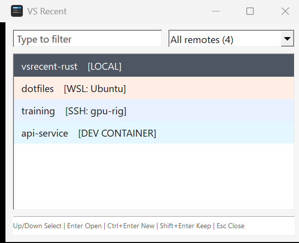
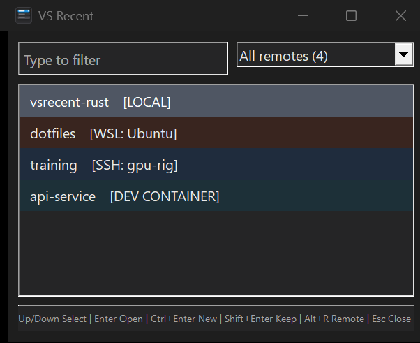

# VS Recent

VS Recent is an instant native picker for folders in VS Code's **Open Recent** history, for Windows and macOS. On Windows, pin it to the taskbar and press the matching `Win+1` through `Win+9` shortcut, type a few characters, and press Enter. On macOS, open it from the Dock or Spotlight the same way.

[Download VS Recent and read how it starts so quickly](https://calebrob.com/vsrecent/).

A tiny tool in the spirit of Scott Hanselman's
[Tiny Tool Town](https://www.tinytooltown.com/) — made for an audience of one,
shared in case it is useful to anyone else.

| Light | Dark |
| --- | --- |
|  |  |

## Install

### Windows

Install the latest x64 or ARM64 release with Windows Package Manager:

```powershell
winget install --id calebrob6.VSRecent --exact
```

### macOS

Download `vsrecent-macos-universal.zip` from the [latest release](https://github.com/calebrob6/vsrecent/releases/latest), unzip it, and move **VS Recent** to the Applications folder. It runs on Apple silicon and Intel Macs with macOS 11 or later.

The app is not notarized by Apple, so macOS blocks the first launch of a downloaded copy. Approve it under **System Settings > Privacy & Security > Open Anyway**, or remove the quarantine flag:

```sh
xattr -dr com.apple.quarantine "/Applications/VS Recent.app"
```

## Features

- Reads `.vscode-shared/sharedStorage/state.vscdb` in the home directory through the SQLite library that ships with the system: `winsqlite3.dll` on Windows and `libsqlite3.dylib` on macOS.
- Preserves local and remote folder URIs for WSL, SSH, Dev Containers, Codespaces, tunnels, and GitHub.
- Follows the system light or dark appearance.
- Colors each row by its local or remote kind for faster visual scanning.
- Filters labels, original URIs, and remote names using case-insensitive AND semantics.
- Uses only system libraries at runtime; Rust dependencies are statically linked.
- Produces a small, self-contained `vsrecent.exe` for x64 and ARM64 Windows, and a universal `VS Recent.app` for Apple silicon and Intel Macs.

## Build

### Windows

Install Rust and the Visual Studio C++ build tools:

```powershell
winget install --id Rustlang.Rustup --exact
winget install --id Microsoft.VisualStudio.2022.BuildTools --exact --override "--wait --passive --add Microsoft.VisualStudio.Workload.VCTools --includeRecommended"
```

Build the optimized executable:

```powershell
build.cmd
```

The result is `publish\vsrecent.exe`.

### macOS

Install Rust and the Xcode command line tools (`xcode-select --install`), then build the universal application:

```sh
sh build-macos.sh
```

The result is `publish/VS Recent.app`, signed ad hoc, and `publish/vsrecent-macos-universal.zip`.

### Demo mode

For a UI smoke test that does not depend on local VS Code history:

```sh
cargo run --release -- --demo
```

Use `--demo --light` or `--demo --dark` to force a theme when updating screenshots. Normal launches follow the system appearance.

### CI

CI builds every supported architecture on native GitHub-hosted runners:

| Artifact | Rust target | Runner |
| --- | --- | --- |
| `vsrecent-win-x64.exe` | `x86_64-pc-windows-msvc` | `windows-latest` |
| `vsrecent-win-arm64.exe` | `aarch64-pc-windows-msvc` | `windows-11-arm` |
| `vsrecent-macos-universal.zip` | `aarch64-apple-darwin` and `x86_64-apple-darwin` | `macos-latest` |

The jobs run for every pull request and manual workflow dispatch. Pushing a `v*` tag builds all three artifacts and attaches them to a GitHub Release.

The macOS job also runs the tests, launches the debug build and the application bundle in demo mode, and uploads screenshots of both as the `macos-screenshots` artifact, so the macOS interface can be reviewed without a Mac.

### Startup benchmark

On Windows, compare startup-to-first-window performance between two optimized builds on the same machine:

```powershell
.\scripts\benchmark-startup.ps1 `
    -BaselineExecutable .\artifacts\main\vsrecent.exe `
    -CandidateExecutable .\publish\vsrecent.exe
```

The benchmark checks that both executables have the same architecture, performs warmups, and reports median and p95 startup times. Close any running VS Recent window before starting it.

## Keys

| Action | Windows | macOS |
| --- | --- | --- |
| Filter recent folders | Type | Type |
| Select all filter text | `Ctrl+A` | `Cmd+A` |
| Move the selection | `Up` / `Down` | `Up` / `Down` |
| Move by eight rows | `PgUp` / `PgDn` | `Page Up` / `Page Down` |
| Select the first or last result | `Ctrl+Home` / `Ctrl+End` | `Home` / `End` or `Cmd+Up` / `Cmd+Down` |
| Open the selected folder and close | `Enter` | `Return` |
| Open in a new VS Code window and close | `Ctrl+Enter` | `Cmd+Return` |
| Open and keep the picker visible | `Shift+Enter` | `Shift+Return` |
| Close | `Esc` | `Esc` |

## Fast launch

### Windows

Copy `vsrecent.exe` to a stable location, launch it once, right-click its taskbar icon, and select **Pin to taskbar**. Move it to the first taskbar position to launch it with `Win+1`.

The included `install.ps1` installs release artifacts and creates a Start Menu shortcut. `vsrecent_hotkey.ahk` remains available for a dedicated global shortcut.

### macOS

Keep **VS Recent** in the Dock, or open it from Spotlight with `Cmd+Space`. For a dedicated global shortcut, create a shortcut in the Shortcuts app with an **Open App** action for VS Recent and assign it a keyboard shortcut.

## Implementation

Startup deliberately performs only native window-class registration and control creation on the UI thread. Once the first paint is requested, a worker thread opens the VS Code database read-only, parses its recent-folder JSON, builds the search index, and posts the completed list to the UI thread. If the live WAL database cannot be read, it snapshots the database and its `-wal` and `-shm` files into a process-specific temporary directory and retries.

The macOS version keeps the same order with AppKit controls: it puts the window on screen, loads the history on a worker thread, and hands the result to the main queue. It opens folders the way VS Code's own `code` command does on macOS, by asking Launch Services for a new instance that forwards `--folder-uri` to the running one.

See [How VS Recent starts quickly](https://calebrob.com/vsrecent/#startup) for a detailed comparison of the Windows version with the former C# WinForms implementation.

## License

[MIT](LICENSE)
